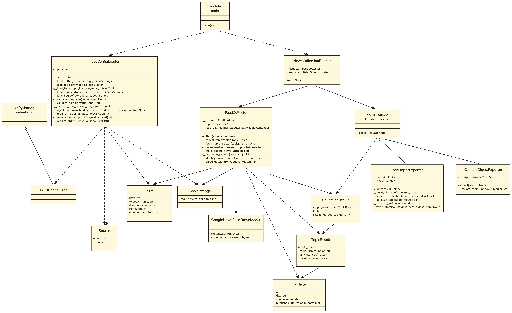

# News Coo

[Português](README.md) | **English**

A news collector that fetches Google News RSS feeds, organizes them by topic, and saves each run as a JSON digest. Feed sources and topics are declared in a single YAML file; the collector builds one Google News query per topic combining all sources, fetches all topics in parallel, and keeps Google's top ranked results.

## Table of contents

- [Features](#features)
- [Requirements](#requirements)
- [Quick start](#quick-start)
- [Project layout](#project-layout)
- [Class diagram](#class-diagram)
- [Configuration](#configuration)
  - [Settings](#settings)
  - [Topics and sources](#topics-and-sources)
- [Usage](#usage)
- [Scripts](#scripts)

## Features

- **Declarative feed configuration.** Topics and sources are defined in `config/feeds.yaml`. Adding a new source is a two-line YAML entry (name + domain) — no code changes required. The collector builds the Google News RSS URL automatically from the topic keywords, source domains, and language.
- **Parallel collection.** All topics are fetched concurrently via `asyncio.gather`. Each topic produces a single Google News query that combines all its sources with `(site:a.com OR site:b.com)`, leveraging Google's own ranking.
- **Google ranking.** Each topic keeps the first `max_articles_per_topic` results of the combined query, in Google News order.
- **Defensive collection.** Feed configuration is validated at startup, Google News URLs are encoded from structured query parameters, RSS downloads use a timeout, transient retries, and a response-size limit.
- **JSON digests and terminal summary.** Each run prints a per-topic summary and writes `output/digest-<UTC timestamp>.json` atomically, so an interrupted run never leaves a truncated file.

## Requirements

- Python 3.14+
- Collection, test, and lint dependencies listed in `requirements.txt`.

## Quick start

```bash
git clone git@github.com:JustSpica/CS-News-coo.git
cd CS-News-coo

python -m venv .venv
source .venv/bin/activate
pip install -r requirements.txt

python main.py
```

A per-topic summary is printed to the terminal and the digest is saved to `output/` (its path is logged).

## Project layout

```text
.
├── _scripts/
│   ├── collect.sh            # Runs one news collection (python main.py)
│   ├── test.sh               # Runs pytest
│   └── lint.sh               # Runs ruff check --fix + ruff format
├── assets/
│   └── uml_diagram.png       # UML class diagram
├── config/
│   ├── settings.py           # Path constants (feeds config, output dir)
│   └── feeds.yaml            # Topic and source declarations
├── core/
│   ├── models.py             # Domain dataclasses (Article, Topic, Source, etc.)
│   ├── feed_loader.py        # FeedConfigLoader: YAML config parser and validator
│   ├── feed_downloader.py    # GoogleNewsFeedDownloader: HTTP download with timeout and retry
│   ├── collector.py          # FeedCollector: parallel topic fetching and RSS parsing
│   └── digest_exporter.py    # DigestExporter base class, JSON and console exporters
├── tests/
│   ├── test_collector.py     # Feed collection, parsing, ranking, URL building
│   ├── test_digest_exporter.py  # Exporter base class, JSON shape, atomic writes, console summary
│   ├── test_feed_downloader.py  # Download size limit and URL scheme check
│   ├── test_feed_loader.py   # YAML loading, defaults, and validation errors
│   └── test_main.py          # Collection runner and entrypoint exit codes
├── main.py                   # Entrypoint: main() and NewsCollectionRunner
├── ruff.toml                 # Linter and formatter configuration
└── requirements.txt          # Pinned collection, test, and lint dependencies
```

`core/` contains the domain models, feed collection, and digest exporters. `main.py` is the entrypoint: `main()` loads the config, builds the collector and exporters, and `NewsCollectionRunner` runs one collection and hands the result to every exporter. `config/` centralizes all configuration.

## Class diagram



The diagram shows the project's 14 classes, plus `ValueError` (the Python class `FeedConfigError` inherits from) and the `main` module. Solid lines with a hollow triangle are inheritance, solid arrows are associations (the class holds a reference to the other) and dashed arrows are dependencies (the class creates, raises or uses the other without holding it). Members marked `+` are public and `-` are private (double underscore in Python).

## Configuration

### Settings

`config/feeds.yaml` accepts a top-level `settings` key with the following options:

| Key | Default | Description |
|---|---|---|
| `max_articles_per_topic` | `15` | Maximum articles kept per topic after collection. Must be between `1` and `50`. |

### Topics and sources

Each topic has a `display_name`, a non-empty list of `keywords` for the search query, a supported `language` (`en` when omitted) that determines the Google News locale, and a non-empty list of `sources` (name + domain). Unknown settings, unknown topic/source fields, unsupported languages, empty keywords, empty sources, and malformed domains fail fast with a configuration error. The collector combines valid entries into a single RSS URL per topic.

```yaml
topics:
  world_economy:
    display_name: "Economia Mundial"
    keywords:
      - "global economy"
      - "world markets"
      - "trade"
    language: en
    sources:
      - name: Reuters
        domain: reuters.com
      - name: Financial Times
        domain: ft.com
```

The combined Google News RSS URL follows this format:

```
https://news.google.com/rss/search?q={keyword1}+OR+{keyword2}+(site:{domain1}+OR+site:{domain2})+when:7d&hl={hl}&gl={gl}&ceid={ceid}
```

Supported languages: `en` (US locale) and `pt` (Brazilian locale). The `when:7d` suffix restricts results to the last 7 days. RSS downloads use a 30-second timeout, retry transient URL/time-out errors up to two times, and reject responses larger than 2 MB.

## Usage

```bash
python main.py            # or ./_scripts/collect.sh
```

All configured topics are fetched in parallel and the result is passed to each exporter in `main.py`. `main()` builds a `FeedConfigLoader` to read the YAML and a `FeedCollector` that receives a `GoogleNewsFeedDownloader` for the downloads. `ConsoleDigestExporter` prints a per-topic summary and `JsonDigestExporter` writes `output/digest-YYYYMMDDTHHMMSSZ.json` (UTC). Both subclass `DigestExporter`, so a new destination only needs a new subclass. The process exits with `0` on success and `1` when the feeds config is missing or invalid, or the digest cannot be written. A topic that fails to download does not abort the run; all of its sources are listed under `failed_sources` in the JSON and on the summary's last line. A source that fails in several topics is listed once per topic. When no topic fails, the `Failed sources` line is not printed and `failed_sources` is empty, as in the examples below.

Terminal summary:

```text
Collected 105 articles across 7 topics:
  - Economia Mundial: 15 articles
  - Economia Brasileira: 15 articles
  ...
```

JSON digest:

```json
{
  "collected_at": "2026-11-05T21:05:58+00:00",
  "total_articles": 105,
  "failed_sources": [],
  "topics": [
    {
      "key": "world_economy",
      "display_name": "Economia Mundial",
      "article_count": 15,
      "failed_sources": [],
      "articles": [
        {
          "title": "Global markets were already fragile... - Reuters",
          "url": "https://news.google.com/rss/articles/...",
          "source_name": "Reuters",
          "published_at": "2026-11-03T05:14:39+00:00"
        }
      ]
    }
  ]
}
```

`published_at` is `null` when the feed entry has no parseable date.

## Scripts

All scripts are in `_scripts/` and activate the virtual environment automatically.

| Script | Usage | Description |
|---|---|---|
| `collect.sh` | `./_scripts/collect.sh` | Run one news collection, print the summary, and save the JSON digest. |
| `test.sh` | `./_scripts/test.sh [-v]` | Run the test suite. Accepts any pytest arguments. |
| `lint.sh` | `./_scripts/lint.sh [--check]` | Run `ruff check --fix` and `ruff format`. Pass `--check` for non-mutating validation. |
