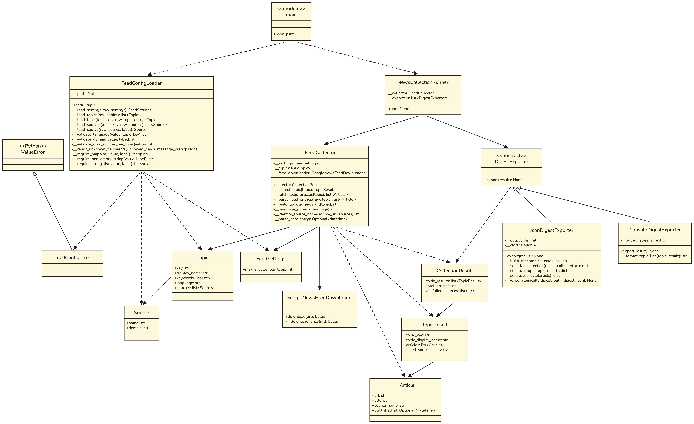

# News Coo: apresentação do projeto

Roteiro para apresentar o projeto final de Programação Orientada a Objetos. Cada seção corresponde a um momento da apresentação: o que mostrar, o trecho de código que prova o requisito e o que falar.

## Roteiro

| # | Parte | Tempo sugerido |
|---|---|---|
| 1 | O problema e a solução | 1 min |
| 2 | Demonstração | 2 min |
| 3 | Visão geral das classes (diagrama UML) | 2 min |
| 4 | Requisitos, um por um | 6 min |
| 5 | Qualidade: testes e validações | 1 min |
| 6 | Fechamento | 30 s |

---

## 1. O problema e a solução

**Problema.** Para acompanhar economia, política e tecnologia, uma pessoa abre vários portais por dia (Reuters, Financial Times, Folha, G1...). Isso toma tempo, e um portal sozinho não mostra o que os outros publicaram sobre o mesmo assunto.

**Solução.** O News Coo reúne essas notícias num só lugar:

1. O usuário declara os tópicos e as fontes em `config/feeds.yaml`.
2. O programa faz uma busca no Google News por tópico, todas ao mesmo tempo.
3. O resultado sai como um resumo no terminal e um arquivo JSON.

Hoje são **7 tópicos**, **28 fontes** e até **15 notícias por tópico**.

---

## 2. Demonstração

```bash
python main.py
```

Saída no terminal:

```text
Collected 105 articles across 7 topics:
  - Economia Mundial: 15 articles
  - Economia Brasileira: 15 articles
  - Economia Brasileira (visão internacional): 15 articles
  - Política Mundial: 15 articles
  - Política Brasileira: 15 articles
  - Tecnologia: 15 articles
  - Inteligência Artificial: 15 articles
```

O que mostrar:

- o resumo no terminal;
- o arquivo gerado em `output/digest-<data>.json`, com título, link, fonte e data de cada notícia;
- (opcional) uma fonte nova acrescentada ao `feeds.yaml` sem mudar nenhuma linha de código.

> **Plano B:** sem internet na sala, rode `./_scripts/test.sh`. Os 42 testes passam sem acessar a rede, e o JSON de uma execução anterior em `output/` serve de exemplo.

---

## 3. Visão geral das classes



O sistema tem **14 classes**, divididas em cinco grupos:

| Grupo | Classes | Papel |
|---|---|---|
| Dados (`core/models.py`) | `FeedSettings`, `Source`, `Topic`, `Article`, `TopicResult`, `CollectionResult` | Guardam as informações que passam de uma parte para outra |
| Configuração (`core/feed_loader.py`) | `FeedConfigLoader`, `FeedConfigError` | Leem e validam o YAML |
| Coleta (`core/collector.py`, `core/feed_downloader.py`) | `FeedCollector`, `GoogleNewsFeedDownloader` | Montam a busca, baixam o RSS e transformam em notícias |
| Saída (`core/digest_exporter.py`) | `DigestExporter`, `JsonDigestExporter`, `ConsoleDigestExporter` | Mostram e gravam o resultado |
| Orquestração (`main.py`) | `NewsCollectionRunner` | Liga a coleta aos exportadores |

**O fluxo, em uma frase:** o `main()` lê a configuração com o `FeedConfigLoader`, monta o `NewsCollectionRunner` com um `FeedCollector` e dois exportadores, e o runner coleta e entrega o resultado a cada exportador.

---

## 4. Requisitos, um por um

| Requisito | Atendido por | Seção |
|---|---|---|
| 100% em Python orientado a objetos | Todo o código fica em classes; `main()` só monta os objetos | [4.1](#41-python-orientado-a-objetos) |
| Pelo menos 5 classes | 14 classes | [4.2](#42-pelo-menos-5-classes) |
| Herança | `JsonDigestExporter` e `ConsoleDigestExporter` herdam de `DigestExporter`; `FeedConfigError` herda de `ValueError` | [4.3](#43-herança) |
| Polimorfismo | `export()` chamado pela classe base em `NewsCollectionRunner.run()` | [4.4](#44-polimorfismo) |
| Associação | `NewsCollectionRunner → FeedCollector`, `FeedCollector → GoogleNewsFeedDownloader`, `Topic → Source` e outras | [4.5](#45-associação) |
| Método privado | `__write_atomically()`, `__collect_topic()`, `__download_once()` e outros | [4.6](#46-método-privado) |
| Atributo privado | `__collector`, `__exporters`, `__feed_downloader`, `__path` e outros | [4.7](#47-atributo-privado) |
| Programa principal cria pelo menos dois objetos | `main()` cria 6 objetos | [4.8](#48-programa-principal-cria-pelo-menos-dois-objetos) |
| Tudo implementado | Sistema completo, com testes | [4.9](#49-tudo-implementado) |

### 4.1 Python orientado a objetos

Toda a lógica está dentro de classes. Fora delas há só:

- a função `main()`, que cria os objetos e devolve o código de saída;
- `_utc_now()`, que devolve a hora atual e serve de relógio padrão do exportador JSON;
- constantes de configuração (caminhos, limites, URLs).

**Fala:** "Cada responsabilidade virou uma classe: ler a configuração, baixar, coletar, exportar e orquestrar."

### 4.2 Pelo menos 5 classes

São **14**:

| Arquivo | Classes |
|---|---|
| `core/models.py` | `FeedSettings`, `Source`, `Topic`, `Article`, `TopicResult`, `CollectionResult` |
| `core/feed_loader.py` | `FeedConfigError`, `FeedConfigLoader` |
| `core/collector.py` | `FeedCollector` |
| `core/feed_downloader.py` | `GoogleNewsFeedDownloader` |
| `core/digest_exporter.py` | `DigestExporter`, `JsonDigestExporter`, `ConsoleDigestExporter` |
| `main.py` | `NewsCollectionRunner` |

### 4.3 Herança

**Caso principal: os exportadores** (`core/digest_exporter.py:24`, `:30`, `:95`)

```python
class DigestExporter:
    def export(self, result: CollectionResult) -> None:
        msg = f"{type(self).__name__} must implement export()"
        raise NotImplementedError(msg)


class JsonDigestExporter(DigestExporter):
    def export(self, result: CollectionResult) -> None:
        ...  # grava o arquivo JSON


class ConsoleDigestExporter(DigestExporter):
    def export(self, result: CollectionResult) -> None:
        ...  # imprime o resumo no terminal
```

`DigestExporter` define o contrato: todo exportador tem `export(result)`. A classe base não sabe exportar e lança `NotImplementedError`, então funciona como classe abstrata. Cada filha implementa o método do seu jeito.

**Segundo caso: a exceção própria** (`core/feed_loader.py:20`)

```python
class FeedConfigError(ValueError):
    pass
```

Herda de uma classe da biblioteca padrão do Python. Ter um tipo próprio permite que o `main()` capture **só** os erros de configuração.

**Fala:** "Para criar um destino novo, como um e-mail ou um CSV, basta outra subclasse de `DigestExporter`. Nenhuma outra classe muda."

### 4.4 Polimorfismo

`main.py:28`

```python
for exporter in self.__exporters:
    exporter.export(result)
```

O `NewsCollectionRunner` guarda uma lista de `DigestExporter` e chama `export()` em cada um **sem saber qual classe concreta está ali**. A mesma chamada imprime o resumo quando o objeto é um `ConsoleDigestExporter` e grava o JSON quando é um `JsonDigestExporter`.

Em `main.py:47`, a lista recebe objetos de classes diferentes:

```python
exporters=[ConsoleDigestExporter(), JsonDigestExporter(DIGEST_OUTPUT_DIR)],
```

**Fala:** "O runner conversa com a classe base. Quem decide o que acontece é o objeto que está na lista."

**Bônus para citar:** os testes também usam polimorfismo. O `CannedFeedDownloader` herda de `GoogleNewsFeedDownloader` e sobrescreve `download()` para devolver um RSS fixo. O `FeedCollector` usa esse objeto falso sem perceber a diferença, e por isso os testes não precisam de internet.

### 4.5 Associação

Uma classe guarda uma referência a outra como atributo:

| De | Para | Multiplicidade | Atributo |
|---|---|---|---|
| `NewsCollectionRunner` | `FeedCollector` | 1 → 1 | `__collector` |
| `NewsCollectionRunner` | `DigestExporter` | 1 → 1..* | `__exporters` |
| `FeedCollector` | `FeedSettings` | 1 → 1 | `__settings` |
| `FeedCollector` | `Topic` | 1 → 0..* | `__topics` |
| `FeedCollector` | `GoogleNewsFeedDownloader` | 1 → 1 | `__feed_downloader` |
| `Topic` | `Source` | 1 → 1..* | `sources` |
| `CollectionResult` | `TopicResult` | 1 → 0..* | `topic_results` |
| `TopicResult` | `Article` | 1 → 0..* | `articles` |

**Exemplo para mostrar:** `core/collector.py:38`

```python
self.__settings = settings
self.__topics = topics
self.__feed_downloader = feed_downloader
```

O `FeedCollector` recebe o downloader pronto pelo construtor, em vez de criá-lo. Por isso o downloader real pode ser trocado por um falso nos testes.

**Fala:** "A multiplicidade `1..*` de `__exporters` é garantida no código: o construtor do runner lança `ValueError` se a lista vier vazia."

### 4.6 Método privado

Em Python, um nome que começa com dois sublinhados (`__`) dentro de uma classe sofre *name mangling*: o Python o renomeia para `_NomeDaClasse__nome`. Por isso, de fora da classe, `objeto.__metodo()` dá `AttributeError`.

Exemplos:

| Classe | Métodos privados | Onde |
|---|---|---|
| `FeedConfigLoader` | `__load_topic()`, `__load_source()`, `__validate_domain()` e mais 9 | `core/feed_loader.py:38` a `:162` |
| `FeedCollector` | `__collect_topic()`, `__fetch_topic_articles()`, `__parse_feed_entries()`, `__build_google_news_url()` e mais 3 | `core/collector.py:57` a `:129` |
| `GoogleNewsFeedDownloader` | `__download_once()` | `core/feed_downloader.py:38` |
| `JsonDigestExporter` | `__build_filename()`, `__serialize_collection()`, `__serialize_topic()`, `__serialize_article()`, `__write_atomically()` | `core/digest_exporter.py:46` a `:78` |
| `ConsoleDigestExporter` | `__format_topic_line()` | `core/digest_exporter.py:110` |

**Exemplo para mostrar:** `core/feed_downloader.py`

```python
class GoogleNewsFeedDownloader:
    def download(self, url: str) -> bytes:          # público
        ...
        return self.__download_once(url)            # chama o privado

    def __download_once(self, url: str) -> bytes:   # privado
        ...
```

**Fala:** "Cada classe expõe um único método público (`load`, `collect`, `download`, `export`, `run`). O resto é detalhe interno, escondido com `__`."

### 4.7 Atributo privado

| Classe | Atributos privados |
|---|---|
| `NewsCollectionRunner` | `__collector`, `__exporters` (`main.py:20`) |
| `FeedConfigLoader` | `__path` (`core/feed_loader.py:26`) |
| `FeedCollector` | `__settings`, `__topics`, `__feed_downloader` (`core/collector.py:38`) |
| `JsonDigestExporter` | `__output_dir`, `__clock` (`core/digest_exporter.py:32`) |
| `ConsoleDigestExporter` | `__output_stream` (`core/digest_exporter.py:97`) |

**Demonstração rápida no terminal (opcional):**

```python
>>> from pathlib import Path
>>> from core.feed_loader import FeedConfigLoader
>>> loader = FeedConfigLoader(Path("config/feeds.yaml"))
>>> loader.__path
AttributeError: 'FeedConfigLoader' object has no attribute '__path'
>>> loader._FeedConfigLoader__path
PosixPath('config/feeds.yaml')
```

**Fala:** "O Python não tem `private` como Java. O que ele faz é renomear o atributo, e isso impede o acesso acidental de fora da classe."

### 4.8 Programa principal cria pelo menos dois objetos

`main.py:38` e `main.py:45`

```python
config_loader = FeedConfigLoader(FEEDS_PATH)
settings, topics = config_loader.load()

runner = NewsCollectionRunner(
    collector=FeedCollector(settings, topics, GoogleNewsFeedDownloader()),
    exporters=[ConsoleDigestExporter(), JsonDigestExporter(DIGEST_OUTPUT_DIR)],
)
asyncio.run(runner.run())
```

O `main()` cria **6 objetos**: `FeedConfigLoader`, `GoogleNewsFeedDownloader`, `FeedCollector`, `ConsoleDigestExporter`, `JsonDigestExporter` e `NewsCollectionRunner`. O `load()` ainda cria um `FeedSettings`, os `Topic` e as `Source`, e a coleta cria os `Article`, `TopicResult` e o `CollectionResult`.

### 4.9 Tudo implementado

Nenhuma parte do sistema é simulada: ele lê a configuração real, acessa o Google News, processa o RSS e grava o arquivo. O programa termina com código `0` em caso de sucesso e `1` quando a configuração é inválida ou o arquivo não pode ser gravado.

---

## 5. Qualidade: testes e validações

- **42 testes automatizados** (`pytest`), que rodam em menos de 1 segundo e não acessam a internet.
- **Validação da configuração:** campos desconhecidos, idioma não suportado, listas vazias e domínios mal formados interrompem a execução com uma mensagem clara.
- **Coleta resistente a falhas:** tempo limite de 30 s, até 2 novas tentativas em falhas de rede e limite de 2 MB por resposta. Um tópico que falha não derruba os outros.
- **Gravação segura:** o JSON é gravado num arquivo temporário e renomeado no fim, então nunca fica um arquivo pela metade.
- **Lint e formatação** com `ruff`.

```bash
./_scripts/test.sh     # 42 passed
./_scripts/lint.sh --check
```

---

## 6. Fechamento

O News Coo atende todos os requisitos com folga:

- **14 classes**, em vez das 5 pedidas;
- **3 relações de herança**: duas filhas de uma classe base abstrata e uma exceção própria;
- **polimorfismo** no laço de exportação, e também nos testes;
- **8 associações**, com multiplicidade;
- **atributos e métodos privados** em todas as classes com comportamento;
- **6 objetos** criados no programa principal.

---

## Perguntas prováveis

**Por que `DigestExporter` não usa `abc.ABC`?**
O `raise NotImplementedError` cumpre o mesmo papel: a classe base define o contrato e não pode ser usada sozinha. Com `abc.ABC` + `@abstractmethod`, o erro apareceria já ao criar o objeto, e não só ao chamar `export()`.

**Qual a diferença entre `_nome` e `__nome`?**
Um sublinhado é só convenção ("uso interno"). Dois sublinhados ativam o *name mangling*, que renomeia o membro e impede o acesso direto de fora e a sobrescrita acidental por subclasses. O projeto usa `__` em todos os membros privados.

**Por que as classes de `models.py` não têm atributos privados?**
Elas são dataclasses: só carregam dados entre as partes do sistema, e as outras classes precisam ler esses dados. Para proteger o conteúdo, quatro delas são imutáveis (`frozen=True`), então ninguém consegue alterar um `Topic` ou um `Article` depois de criado.

**Por que `FeedCollector` recebe o downloader em vez de criá-lo?**
É injeção de dependência. Isso deixa o coletor testável: nos testes ele recebe um downloader falso, que devolve RSS fixo sem internet.

**Como as buscas rodam em paralelo?**
`asyncio.gather` dispara a coleta de todos os tópicos ao mesmo tempo, e `asyncio.to_thread` roda cada download numa thread. A coleta leva mais ou menos o tempo do tópico mais lento, não a soma de todos.

**O que acontece se um site estiver fora do ar?**
O download tenta de novo até 2 vezes. Se ainda falhar, as fontes daquele tópico aparecem em "Failed sources", e os outros tópicos seguem normalmente.

**Por que Python 3.14?**
O projeto usa a sintaxe `except ValueError, TypeError:` (sem parênteses), que só existe a partir do Python 3.14.
